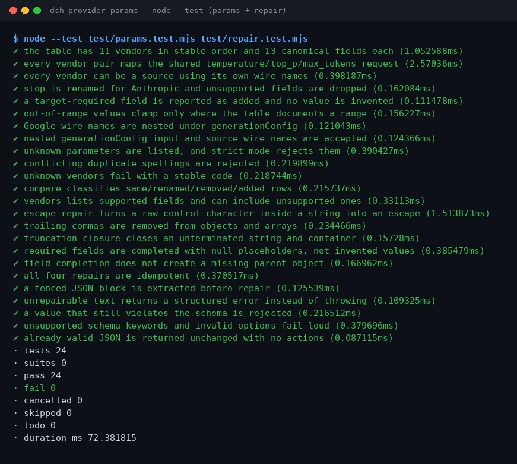

<div align="center">

# dsh-provider-params

**11 家模型厂商的参数映射 + 确定性 JSON 修复。**

[](https://www.npmjs.com/package/dsh-provider-params)
[](LICENSE)
[](https://github.com/topics/dsh-plugin)
[](#)

> **状态：alpha / 公开合成 / 非 GA。** 只读工具，不联网、不写文件、不调用模型。

</div>

## 一句话

把 11 家模型厂商的请求参数互相映射，并按固定规则修好坏掉的 JSON 输出。

## 适合 / 不适合

**适合**

- 在 OpenAI、Claude、Gemini、ERNIE、Qwen、DeepSeek 等厂商之间迁移 `temperature`、`top_p`、`max_tokens`、`stop`、`system` 等请求字段。
- 需要审计某个参数到底是被**改名**、**丢弃**、**夹到范围内**，还是目标厂商**必填但源请求没给**。
- 工具返回的 JSON 带尾逗号、未转义换行或被截断，需要先确定性修好再解析。

**不适合**

- 不适合让模型“猜”缺失的业务字段，或调用厂商 API：本包不联网、不调用模型，也不会编造值。
- 不适合替代厂商 SDK、鉴权、流式调用或完整的请求构造；它只处理参数片段和文本。

## 输入

- `params.map`：`from`（源厂商）、`to`（目标厂商）、`params`（JSON 对象）。`params` 可以用源厂商的 wire name，也可以直接用 canonical 名称；Google 的 `generationConfig` 既可以用嵌套对象，也可以用点号键。可选 `strict: true` 让未知键直接报错。
- `params.compare`：`from`、`to` 两个厂商 id。
- `params.vendors`：可选 `vendor` 过滤，可选 `include_unsupported: true` 显示无等价字段。
- `json.repair`：`text`（UTF-8 字符串，可以带 Markdown 代码围栏）；可选 `schema`（仅支持 `type/properties/required/additionalProperties/items/enum/const`）；可选 `strategies` 四个开关；可选 `max_steps`（1–64）。
- 规模：文本在内存中扫描，受宿主单次工具调用的参数上限约束；本包不读取任何文件。
- 自带样例：`samples/quickstart/input/params-request.json` 与 `samples/quickstart/input/broken-tool-output.json`。

## 输出

- `params.map`：目标厂商的 wire 形状（`mapped`），以及 `dropped`（目标无等价）、`added`（目标必填但输入未给，**不含值**）、`adjusted`（被文档化范围夹住）、`unknown`（无法识别的键）四个列表。
- `params.compare`：13 行语义差异表，每行标记 `same / renamed / removed / added / absent`，并给出两端的 wire name、是否必填、文档范围与备注。
- `params.vendors`：支持的厂商及其字段（名称、是否支持、是否必填、范围、备注）。
- `json.repair`：`ok`、`repaired`（文本或 `null`）、`value`、`actions`（每一次编辑）、`strategies`、`truncated`、`validated`、`placeholders`、`error`。
- 输出只落在工具结果里；**不写文件、不改原文件、不联网**。四个工具都是 R0（只读）。

## 示例

> 用自带样例把我这段 OpenAI 的 temperature/top_p/max_tokens/stop 转成 Anthropic 参数，再把我那段带换行的坏 JSON 修好

```sh
node samples/quickstart/run.mjs
```

参数样例 [`params-request.json`](samples/quickstart/input/params-request.json) 的 `temperature` 是 1.35，目标 Anthropic 的文档范围是 0..1，所以结果为 `temperature: 1`，并在 `adjusted` 里记录 1.35 → 1；`stop` 改名为 `stop_sequences`；`frequency_penalty` 在 Anthropic 无等价，进入 `dropped`。金标在 [`params-mapped.json`](samples/quickstart/expected/params-mapped.json)。

坏 JSON 样例 [`broken-tool-output.json`](samples/quickstart/input/broken-tool-output.json) 的 `note` 里有真实换行，数组末尾还有尾逗号；修复后 `ok: true`，`actions` 依次记录 `escape` 与 `strip`，`strategies` 为 `escapeRepair,trailingComma`。金标在 [`json-repaired.json`](samples/quickstart/expected/json-repaired.json)。



*截图由真实 `node --test test/params.test.mjs test/repair.test.mjs` 输出渲染（24/24 通过）；完整套件 33/33 见下文“版本”。命令、时间和输出哈希记录在 `screenshots.json`。*

## 权限

读：调用方传入的参数对象或 JSON 文本；不读取其他目录  
写：无（R0，不写文件、不改原文件）  
联网：否（不发起任何网络请求，本包没有网络开关）  
外部系统：无

## FAQ

**装不上 / 看不到工具？**
先确认 profile 已加载本包：`dsh --profile <profile> --dump-config | grep dsh-provider-params`。插件只依赖 `tools` 服务；若宿主没有该服务，挂载会失败。错误码见 [`TROUBLESHOOTING.md`](TROUBLESHOOTING.md)。

**映射结果和预期不一样？**
先看 `dropped` 和 `adjusted`：目标厂商可能确实没有该字段，或者值被文档范围夹住了。再用 `params.compare` 看两端的 wire name 与范围。未知键会出现在 `unknown`，不会静默进入结果。

**能处理我的文件吗？**
不能直接读文件。把 JSON 文本作为 `text` 传入 `json.repair`；把请求片段作为对象传入 `params.map`。本包不访问磁盘、不联网、不调用模型。

**缺失字段会被编造吗？**
不会。`added` 只报告目标厂商必填但输入没有的字段，不带值；`json.repair` 的必填补全只写 `null` 占位，并把路径放进 `placeholders`。占位符不是数据，需要调用方补真实值。

**和已发布的 `dsh-translate` 是什么关系？**
本包把 `dsh-translate` 中的厂商参数映射与确定性 JSON 修复能力按新包结构重写、补测试和文档；`dsh-translate` 保持原样。两者都来自 PerryLink 自有代码，Apache-2.0。

## 版本

- 版本：`0.1.0`（与 `package.json` 一致）。
- 测试：`node --test test/*.test.mjs`，33 个测试通过，0 失败（2026-11-02）。
- 状态：alpha / 公开合成 / not counted / 非 GA；不含客户数据或客户证据。

## 安装

```sh
dsh plugin --profile <profile> add dsh-provider-params
dsh --profile <profile> --dump-config | grep dsh-provider-params
```

卸载：

```sh
dsh plugin --profile <profile> remove dsh-provider-params
```

## 工具

工具名是稳定 API；四个工具都只读、确定性、无网络。

| 工具 | 用途 | 风险 |
|---|---|---|
| `params.map` | 把源厂商请求片段映射到目标厂商，返回 mapped/dropped/added/adjusted/unknown | R0 |
| `params.compare` | 两个厂商的 13 行参数语义差异表 | R0 |
| `params.vendors` | 列出 11 家厂商及其字段 | R0 |
| `json.repair` | 确定性修复坏 JSON，返回动作列表与占位符 | R0 |

## 映射规则

1. **只做表里写过的事。** `supported: false` 的字段进入 `dropped`，不会猜一个看起来合理的名字。
2. **必填不等于自动补值。** Anthropic 的 `max_tokens` 是必填；输入没给时只进 `added`，`mapped` 里不会出现凭空的值。
3. **范围只在文档写明时夹。** 目前显式 clamp 的是 ERNIE `temperature`（0.01..1）与 Anthropic `temperature`（0..1）；其余厂商即使备注了范围，也不擅自改值。
4. **别名冲突要报错。** canonical 名和源厂商 wire name 同时给出且值不同，返回 `E_PARAMS_CONFLICT`。
5. **Google 嵌套。** `generationConfig.*` 在输出中还原为嵌套对象；输入也接受嵌套对象。

## JSON 修复规则

按固定顺序执行，全部是文本/结构操作，不调用模型：

| 策略 | 做什么 | 不做什么 |
|---|---|---|
| `escapeRepair` | 把字符串里的原始控制字符转成 `\n`、`\t`、`\uXXXX` 等 | 不改字符串以外的空白 |
| `trailingComma` | 删除 `}` / `]` 前的尾逗号 | 不删除正常分隔符 |
| `truncationClosure` | 补齐被截断的字符串与容器 | 不把缺失内容猜成业务数据 |
| `fieldCompletion` | 给已存在对象的缺失必填字段写 `null` | 不创建缺失的父对象，不编造值 |

`json.repair` 只接受 `{` 或 `[` 根；其他根返回 `E_JSON_NOT_CONTAINER`。`schema` 只支持 `type`、`properties`、`required`、`additionalProperties`、`items`、`enum`、`const`；其他关键字会以 `E_JSON_SCHEMA_UNSUPPORTED` 拒绝，避免“看起来校验了其实没校验”。修复后仍违反 schema 的值会被拒绝（`E_JSON_SCHEMA_VIOLATION`），不会把原始坏文本当成功返回。

## 错误

| 错误码 | 含义 | 下一步 |
|---|---|---|
| `E_PARAMS_UNKNOWN_VENDOR` | 厂商 id 不在表里 | 用 `params.vendors` 查看 11 个 id |
| `E_PARAMS_UNKNOWN_PARAM` | `strict: true` 下有未知键 | 删掉未知键或改用 `strict: false` |
| `E_PARAMS_CONFLICT` | 同一参数用两种写法给了不同值 | 只保留一种写法 |
| `E_JSON_NOT_CONTAINER` | 文本根不是对象或数组 | 传工具输出里的 `{...}` / `[...]` 片段 |
| `E_JSON_UNREPAIRABLE` | 文本在启用的策略下仍无法解析 | 关闭/开启策略重试，或让上游返回完整 JSON |
| `E_JSON_SCHEMA_VIOLATION` | 修复后仍违反 schema | 看 `error.message` 指出的路径，补真实值 |
| `E_JSON_SCHEMA_UNSUPPORTED` | schema 用了不支持的关键字 | 改用支持子集 |

更多排查步骤见 [`TROUBLESHOOTING.md`](TROUBLESHOOTING.md)。

## 开发

```sh
pnpm install
pnpm build
node --test test/*.test.mjs
node scripts/gate.mjs
```

`node scripts/gate.mjs` 依次执行 lint、`tsc --noEmit`、构建、验收脚本和全部测试；验收行写入 `ACCEPTANCE.csv`（public/synthetic，全部 `counted=false`）。

## 兼容性

| 维度 | 状态 |
|---|---|
| Harness | `dsh >=0.2.1-rc.3 <0.4.0` |
| Node | `>=24.9.0 <25` |
| 平台 | 全部；纯内存计算 |
| 数据 | 无网络、无模型调用、无上传 |
| 依赖 | `@deepseek-ai/cordis`、`@deepseek-ai/dsh-tools`（optional peer）；无新增运行时依赖 |

## 许可

Apache-2.0。映射表的三家 `ported` 厂商来自 PerryLink 的 GPT-Rosetta-Stone（Apache-2.0），其余 `extended` 行按各厂商公开 API 文档整理。详见 `LICENSE`。
