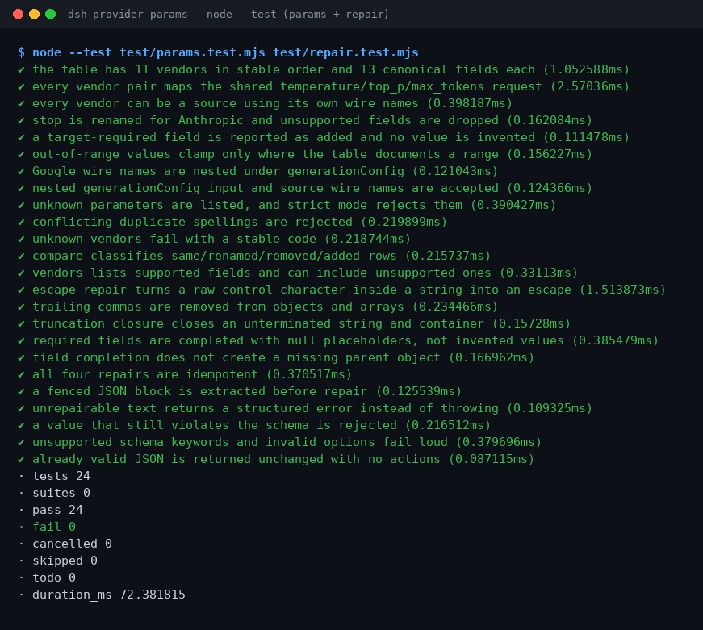

# dsh-provider-params

**Vendor parameter mapping and deterministic JSON repair for DeepSeek Harness.**

> **Status: alpha / public synthetic / not GA.** Read-only tools: no network, no file writes, no model calls.

## One line

Map request parameters across 11 LLM vendors and repair broken JSON output with fixed, auditable rules.

## Good fit / Not a fit

**Good fit**

- Moving `temperature`, `top_p`, `max_tokens`, `stop`, `system` and related fields between OpenAI, Claude, Gemini, ERNIE, Qwen, DeepSeek and five more vendors.
- Auditing whether a parameter was renamed, dropped, clamped to a documented range, or is required by the target but absent from the source.
- Repairing tool output that contains raw newlines, trailing commas, or a truncated string/container before parsing it.

**Not a fit**

- Guessing missing business data or calling a vendor API. This package never invents a value and has no network path.
- Replacing a vendor SDK, auth, streaming, or full request construction. It works on a parameter fragment and text only.

## Input

- `params.map`: `from`, `to`, and a JSON `params` object. Fields may use source-vendor wire names or canonical names; Google's `generationConfig` may be nested or dotted. Optional `strict: true` rejects unknown keys.
- `params.compare`: two vendor ids.
- `params.vendors`: optional `vendor` filter and `include_unsupported`.
- `json.repair`: `text` (UTF-8, fences accepted), optional `schema` (subset: `type/properties/required/additionalProperties/items/enum/const`), optional four strategy switches, optional `max_steps` 1–64.
- Bundled samples: `samples/quickstart/input/params-request.json` and `samples/quickstart/input/broken-tool-output.json`.

## Output

- `params.map`: the target wire object plus `dropped`, `added`, `adjusted`, and `unknown` lists.
- `params.compare`: 13 semantic rows classified `same / renamed / removed / added / absent`.
- `params.vendors`: 11 vendors with each field's wire name, support flag, required flag, range, and notes.
- `json.repair`: `ok`, `repaired`, `value`, `actions`, `strategies`, `truncated`, `validated`, `placeholders`, `error`.
- Nothing is written to disk and the input file is never modified. All four tools are R0 (read-only).

## Example

> 用自带样例把我这段 OpenAI 的 temperature/top_p/max_tokens/stop 转成 Anthropic 参数，再把我那段带换行的坏 JSON 修好

```sh
node samples/quickstart/run.mjs
```

- [`params-request.json`](samples/quickstart/input/params-request.json) maps OpenAI `temperature: 1.35` to Anthropic `temperature: 1` (documented 0..1 clamp, recorded in `adjusted`), renames `stop` to `stop_sequences`, and drops `frequency_penalty` with a reason. Golden: [`params-mapped.json`](samples/quickstart/expected/params-mapped.json).
- [`broken-tool-output.json`](samples/quickstart/input/broken-tool-output.json) contains a raw newline inside `note` and a trailing comma. The repair records an `escape` action and a `strip` action. Golden: [`json-repaired.json`](samples/quickstart/expected/json-repaired.json).



*The screenshot is rendered from real `node --test test/params.test.mjs test/repair.test.mjs` output (24/24 passed); the full suite is 33/33 in Version. Command, date, and hash are recorded in `screenshots.json`.*

## Permissions

Read: the caller-supplied parameter object or JSON text; no other directory
Write: none (R0, no file writes, original untouched)
Network: no (no request path and no network switch)
External systems: none

## FAQ

**I installed it but cannot see the tools.** Check `dsh --profile <profile> --dump-config | grep dsh-provider-params`. The plugin depends on the `tools` service only; see `TROUBLESHOOTING.md` for codes.

**The mapped result looks different from what I expected.** Inspect `dropped` and `adjusted` first: the target may have no equivalent or may document a narrower range. Use `params.compare` to see both wire names and ranges. Unknown keys appear in `unknown`; they never silently enter the result.

**Can it process my files?** Not directly. Pass JSON text as `json.repair.text` and a parameter object as `params.map.params`. It does not read disk, call the network, or call a model.

**Does it invent missing fields?** No. `added` reports target-required fields without values. Required-field completion writes only `null` placeholders and reports their paths in `placeholders`; the caller must supply real values.

## Version

- Version: `0.1.0-alpha.1` (matches `package.json`).
- Tests: `node --test test/*.test.mjs` — 33 passed, 0 failed (2026-11-02).
- Status: alpha / public synthetic / not counted / not GA; no customer data or evidence.

## Install

```sh
dsh plugin --profile <profile> add dsh-provider-params
dsh --profile <profile> --dump-config | grep dsh-provider-params

# remove
dsh plugin --profile <profile> remove dsh-provider-params
```

## Tools

| Tool | Purpose | Risk |
|---|---|---|
| `params.map` | Map a source-vendor request fragment to a target vendor and report mapped/dropped/added/adjusted/unknown | R0 |
| `params.compare` | 13-row semantic parameter comparison between two vendors | R0 |
| `params.vendors` | List 11 vendors and their fields | R0 |
| `json.repair` | Deterministically repair broken JSON and return the action list and placeholders | R0 |

## Mapping rules

1. **Only what the table states.** A `supported: false` cell is dropped with a reason, never renamed to a plausible-looking field.
2. **Required does not mean invented.** Anthropic `max_tokens` is required; if the input omits it, it appears in `added` and never in `mapped` with a fabricated value.
3. **Clamp only documented ranges.** ERNIE `temperature` (0.01..1) and Anthropic `temperature` (0..1) are enforced; other documented notes do not silently rewrite a value.
4. **Conflicting aliases fail.** Supplying a canonical name and a source wire name with different values returns `E_PARAMS_CONFLICT`.
5. **Google nesting.** `generationConfig.*` is emitted as a nested object; nested input is accepted too.

## JSON repair rules

The pipeline is fixed and never calls a model:

| Strategy | Does | Does not |
|---|---|---|
| `escapeRepair` | Escapes raw control characters inside strings (`\n`, `\t`, `\uXXXX`) | Touch whitespace outside strings |
| `trailingComma` | Removes a comma directly before `}` / `]` | Remove a real separator |
| `truncationClosure` | Closes a truncated string and open containers | Guess missing business data |
| `fieldCompletion` | Writes `null` for a missing required field on an existing object | Create a missing parent object or invent a value |

`json.repair` accepts object/array roots only; other roots return `E_JSON_NOT_CONTAINER`. The schema subset is `type`, `properties`, `required`, `additionalProperties`, `items`, `enum`, `const`. Other keywords are rejected with `E_JSON_SCHEMA_UNSUPPORTED` rather than validating nothing. A value that still violates the schema fails closed with `E_JSON_SCHEMA_VIOLATION`.

## Development

```sh
pnpm install
pnpm build
node --test test/*.test.mjs
node scripts/gate.mjs
```

`node scripts/gate.mjs` runs lint, `tsc --noEmit`, the build, the acceptance script, and every test. Acceptance rows are written to `ACCEPTANCE.csv` as public/synthetic, `counted=false`.

## Compatibility

| Dimension | State |
|---|---|
| Harness | `dsh >=0.2.1-rc.3 <0.4.0` |
| Node | `>=24.9.0 <25` |
| Platforms | All; in-memory computation only |
| Data | No network, no model call, no upload |
| Dependencies | `@deepseek-ai/cordis`, `@deepseek-ai/dsh-tools` (optional peer); no new runtime dependency |

## License

Apache-2.0. The three `ported` vendor rows come from PerryLink's GPT-Rosetta-Stone (Apache-2.0); the `extended` rows follow each vendor's public API reference. See `LICENSE`.
